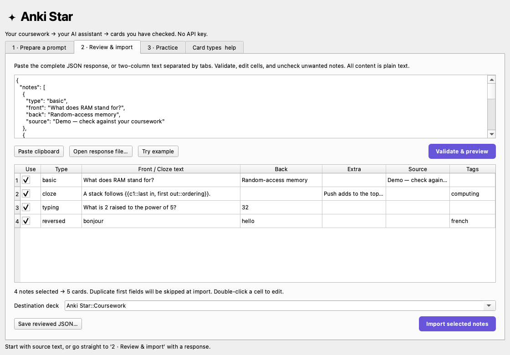

# ✦ Anki Star

**Turn coursework into Anki cards using the AI assistant you already use. No API key.**

An independent, open-source desktop add-on, designed first for macOS. Prepare a
prompt, paste it into your NotebookLM notebook or an assistant chat, bring back
the response, and review the cards before adding them to Anki.



## Install on Mac

1. Download **anki-star-0.1.0-macos.ankiaddon** from
   [Releases](https://github.com/MilesatAshvantAnand/anki-star/releases).
2. In Anki, choose **Tools → Add-ons → Install from file…** and select it.
3. Restart Anki. Open **Tools → Anki Star…**.

Use the macOS package for built-in local OCR (macOS 13+, Apple Silicon and Intel
binary included; Intel runtime is not yet tested). The smaller generic package
omits OCR. No extra Python installation, browser extension or developer tools are
needed to use either packaged add-on. Compatibility evidence is in
[Validation](docs/VALIDATION.md); this is an initial release.

## Your study workflow

1. **Prepare a prompt.** Paste text, read text from a picture/screenshot, or leave
   context empty if your sources are already in NotebookLM. Choose a focus,
   maximum note count and style. Click **Copy prompt**.
2. **Use your assistant.** Paste into the notebook containing your coursework, or
   an assistant chat with the source text/images attached. Ask it to produce the
   JSON response requested by the prompt. Account/usage limits still apply.
3. **Review & import.** Paste the whole response, validate it, double-click cells
   to edit, uncheck unwanted notes and select a destination deck. Import creates
   one undo step. Reimporting the same first field/type skips duplicates.
4. **Study.** Use Anki’s normal daily reviews. Optional Flashcards, Learn, Test
   and Match sessions provide extra practice without changing your due dates.

Use **Try example → Validate & preview** to explore the interface without using
an assistant. The example is not imported until you click Import.

## What it supports

- Basic, Reversed, Type Answer and Cloze in the same batch.
- Source references, extra explanation, tags and per-note selection.
- JSON or simple Front-TAB-Back text; optional Tags column.
- Local image text recognition on macOS using Apple Vision; clipboard pictures
  supported. Extracted text is editable before it goes into the prompt.
- Separate local practice: choice → typed recall with repeated misses, mixed
  tests, reveal/self-check flashcards, and timed matching.
- Export of reviewed notes as JSON for later editing/reimport through Anki Star.

It does not automatically connect to NotebookLM/ChatGPT, generate questions on
its own, interpret diagrams, produce audio, or install Image Occlusion templates.
Anki already includes Image Occlusion. Practice loads the current reviewed batch
or saved Anki Star notes; arbitrary existing note types are not mapped yet.

## Understand Anki formats

A **note** holds fields. A **card** is one question generated from a note. Basic
creates one card; Reversed creates two; Cloze creates a card per deletion number.
TSV/CSV and APKG are import file formats, not card styles. Our JSON is an exchange
format for this add-on, not an Anki standard.

See the in-app **Card types & help** tab and the
[research and feature comparison](docs/RESEARCH.md) for examples, existing
add-ons, their tradeoffs, and what we can recreate from Quizlet.

## JSON example

```json
{
  "notes": [
    {
      "type": "basic",
      "front": "What does RAM stand for?",
      "back": "Random-access memory",
      "extra": "",
      "source": "Lecture 1, slide 4",
      "tags": ["computing::memory"]
    },
    {
      "type": "cloze",
      "front": "A stack follows {{c1::last in, first out}}.",
      "back": "",
      "extra": "Push and pop operate at the top.",
      "source": "Lecture 2",
      "tags": ["computing::structures"]
    }
  ]
}
```

Fields are plain text, not HTML or media markup. Nested clozes are not supported.
Batch limit: 500 notes, 2 MB of pasted text. Duplicate checking is exact first
field within the same Anki Star note type, across all decks. It does not merge
similar questions, update existing notes, or deduplicate against other note types.

## Privacy

The add-on makes no network requests, stores no AI credentials, and does not
watch the clipboard. Copying a prompt places coursework on the system clipboard;
pasting into an assistant shares it with that service. Local OCR reads the image
on your Mac. Clipboard images use a temporary PNG removed after recognition.
Unsaved source/drafts are held in memory for the profile session; saving JSON or
importing notes persists them. Normal Anki sync can sync imported notes.

## Develop

```sh
python3 -m venv .venv
.venv/bin/python -m pip install -r requirements-dev.txt
.venv/bin/python -m pytest -q
.venv/bin/ruff check .
.venv/bin/python tools/build.py
# macOS + Xcode command line tools: include universal Apple Vision helper
.venv/bin/python tools/build.py --macos-ocr
```

See [Contributing](CONTRIBUTING.md). MIT licensed. This project is not affiliated
with Anki, Quizlet, Google or OpenAI. Third-party services and Anki have their own
licenses and terms.
